# IAM Lab 2: Identity Help Desk Operations

## Objective

Most of the identity work that hits a help desk queue is the same four problems: someone's locked out, someone forgot their password, someone's account is disabled, and someone just left the company. I've handled the user side of these at Spectrum and Novant. This lab is the admin side. I set up a lockout policy on the Cedar Ridge Clinic domain from [Lab 1](../iam-01-active-directory-build/), broke a few accounts on purpose, then worked each one as a ticket: investigate, fix, and prove the fix worked by logging in as that user.

## Tools Used

- Active Directory Users and Computers (ADUC)
- PowerShell with the ActiveDirectory module
- Windows Security event log (Event ID 4740)
- `auditpol`
- The DC01 and CLIENT01 VMs from Lab 1

## Lab Environment

Same lab as Lab 1. DC01 (192.168.10.10) is the domain controller for `cedarridge.local`, and CLIENT01 (192.168.10.20) is the Windows 11 workstation, both on the isolated `iamlab` network. All the fixes were done on DC01, and every fix was tested by signing into CLIENT01 as the affected user.

## Setup

### Lockout policy

The domain had no lockout policy, which means someone could guess passwords forever. I set it to lock an account after 5 bad passwords, keep it locked for 30 minutes, and reset the bad-password counter after 15 minutes.

```
Set-ADDefaultDomainPasswordPolicy -Identity cedarridge.local -LockoutThreshold 5 -LockoutDuration 00:30:00 -LockoutObservationWindow 00:15:00
```

I also turned on auditing for account management, so the domain controller logs an event every time an account gets locked:

```
auditpol /set /subcategory:"User Account Management" /success:enable /failure:enable
```

Both are in [lab2-setup.ps1](scripts/lab2-setup.ps1), which also disables Jordan Blake's account for Ticket 3.

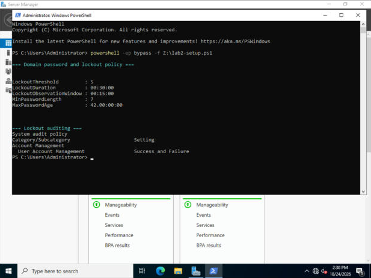

### Locking out a user on purpose

From CLIENT01, I threw wrong passwords at Maria Reyes's account until it locked:

```
1..6 | ForEach-Object { net use \\DC01\NETLOGON /user:CEDARRIDGE\mreyes WrongPassword1 }
```

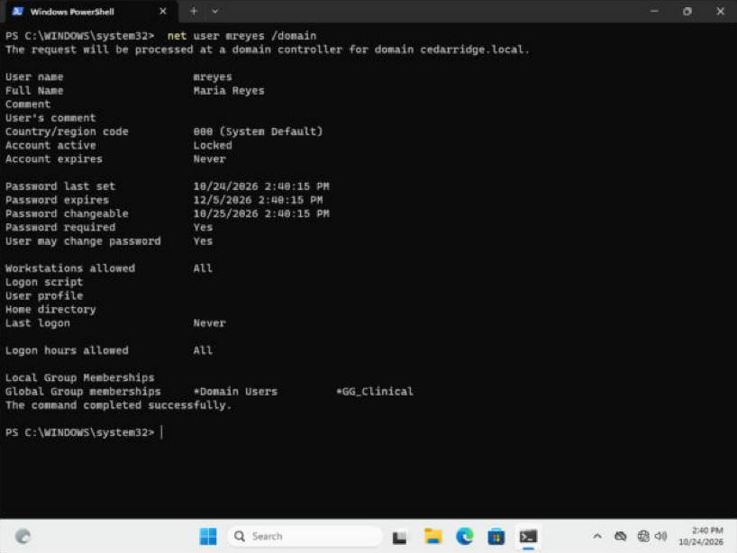

## The Tickets

### INC-1001: Locked account

> Maria Reyes (RN, Clinical) called. Her computer says her account is locked and she can't chart.

**Investigate.** In ADUC I opened Maria's account and went to the Account tab. It said "This account is currently locked out on this Active Directory Domain Controller."

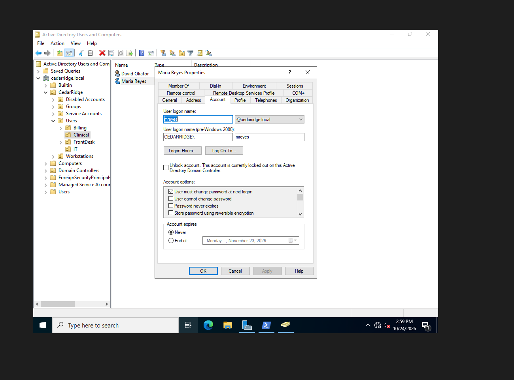

Unlocking her fixes the call, but it doesn't tell you why it happened. If an old phone or laptop has her old password saved, she'll just get locked out again an hour later. So I pulled the lockout event from the domain controller's Security log:

```
Get-WinEvent -FilterHashtable @{LogName='Security'; Id=4740} -MaxEvents 3 | Format-List TimeCreated, Message
```

Event 4740 names the account that got locked (`mreyes`) and, more importantly, the **Caller Computer Name**: `CLIENT01`. That's the machine the bad passwords came from. In a real environment that's how you track down the device that keeps locking someone out.

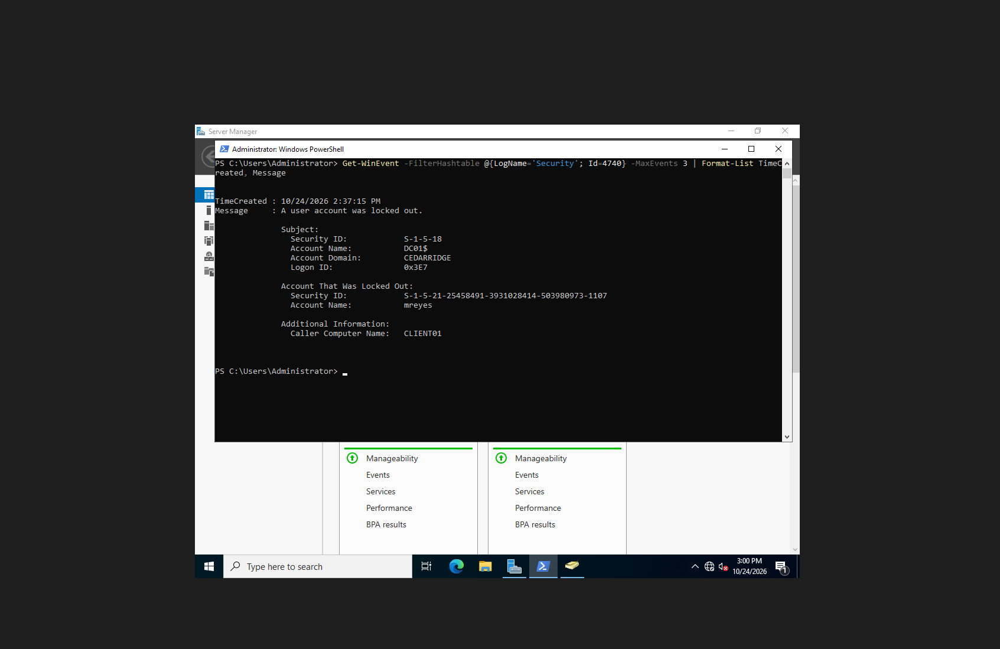

**Fix.** Checked **Unlock account** on the Account tab and clicked Apply.

**Verify.** Signed into CLIENT01 as `mreyes`. Her account still had "must change password at next logon" set from Lab 1, so Windows made her pick a new password. My first try got rejected (see Challenges). Once she was in:

```
whoami; whoami /groups | findstr GG_
```

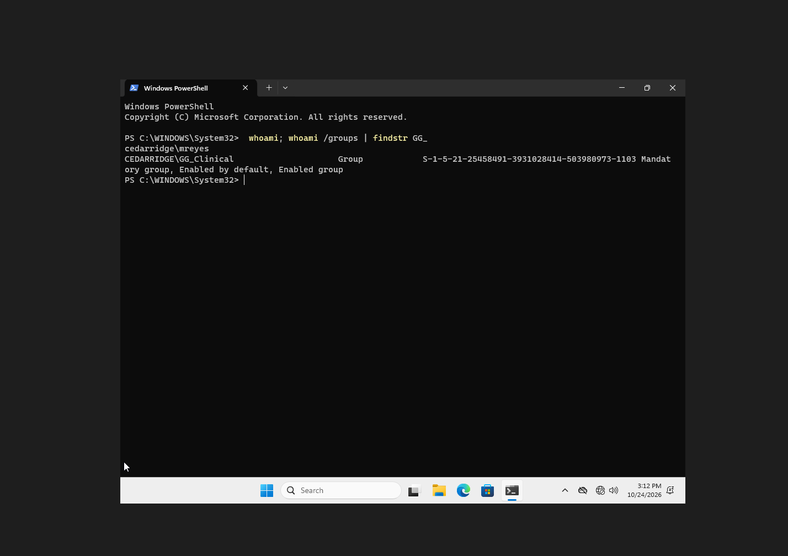

`cedarridge\mreyes` with `GG_Clinical`. Ticket closed.

### INC-1002: Forgot password

> Tom Becker (Billing Manager) forgot his password after vacation. Identity verified by callback to his desk extension.

The "identity verified" part is the most important line in that ticket. A password reset hands someone the keys to an account, so you confirm you're talking to the real person before you touch it. Calling back to a number already on file is one common way to do that. Social engineering the help desk into a reset is a real attack, and it's how some big breaches started.

**Fix.** In ADUC, right-clicked Tom Becker, then Reset Password. I set a temporary password and left **User must change password at next logon** checked, so I never know his real password.

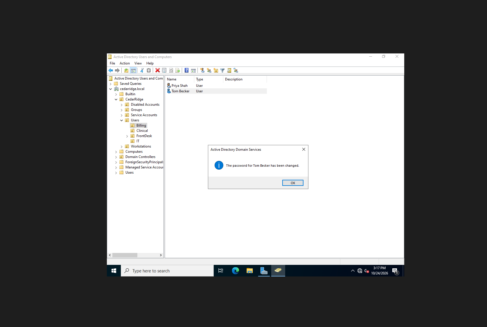

**Verify.** Signed into CLIENT01 as `tbecker` with the temporary password. Windows made him set his own, and his desktop loaded.

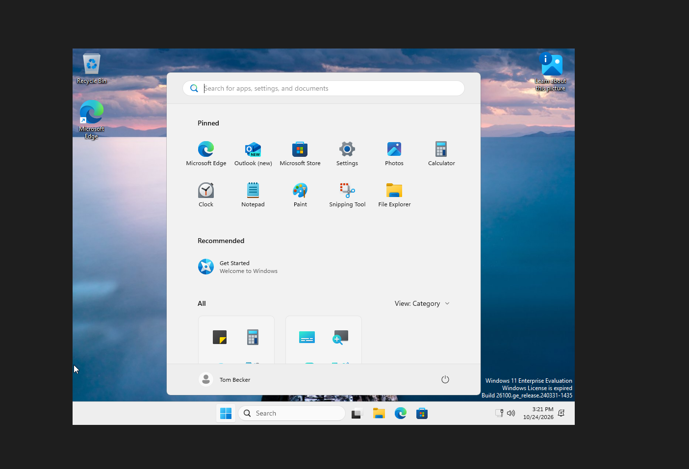

### INC-1003: Disabled account

> Jordan Blake (Help Desk) is back from leave today and can't log in. Manager approved re-enabling his account.

**Investigate.** In ADUC, Jordan's icon in the IT OU had a small down arrow on it. That's how ADUC shows a disabled account.

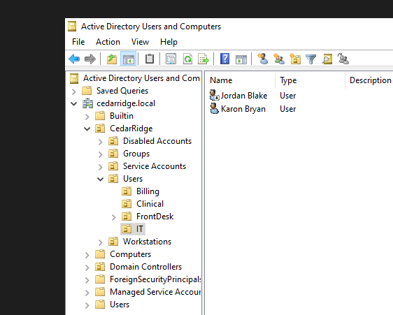

**Fix.** The manager approval is on the ticket, so I right-clicked Jordan and chose Enable Account.

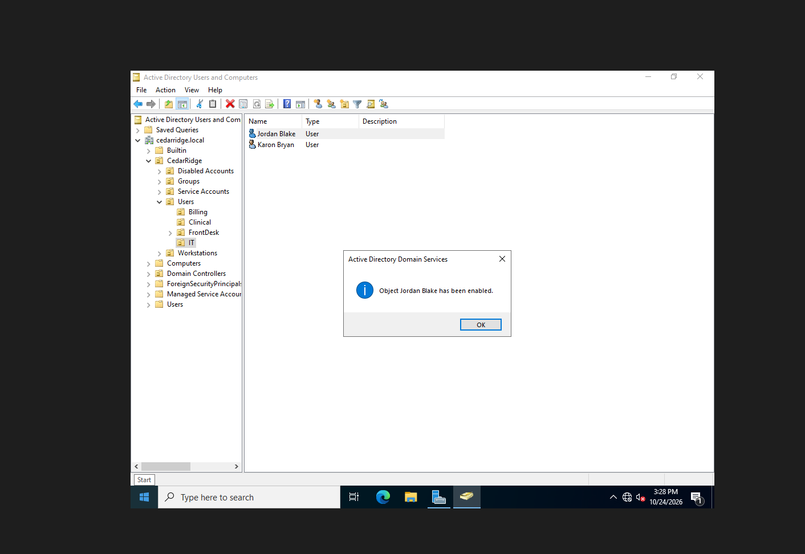

**Verify.** Signed into CLIENT01 as `jblake`, set his new password, and got to his desktop.

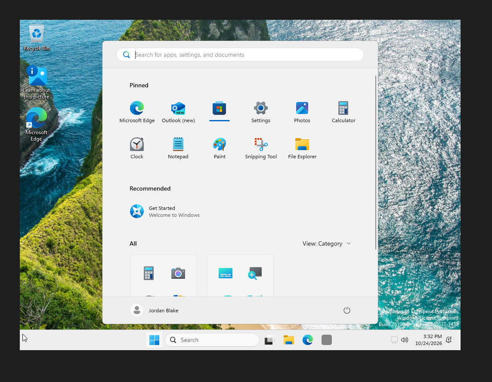

### INC-1004: Offboarding

> HR notice: Marcus Hill (Receptionist, FrontDesk). Today is his last day. Remove access at end of shift.

This is the one that matters most from a security standpoint. Accounts that stay active after someone leaves are one of the most common audit findings, and they're an easy way in for an attacker or an unhappy ex-employee. I didn't delete the account. Deleting it on day one throws away the record of what he had access to, and that record can be needed later for an audit, a legal hold, or to hand his files to his replacement.

**Step 1. Disable the account.**

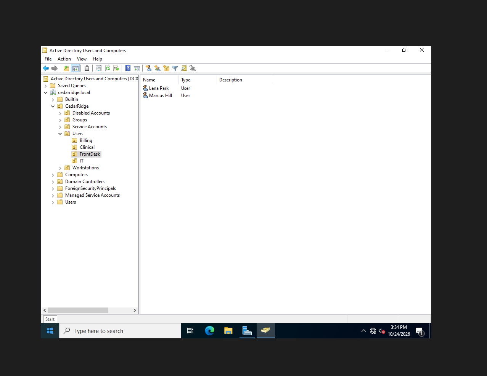

**Step 2. Leave a note on the account.** In the Description field I put `Disabled 10/24/2026 per INC-1004 (offboarding)`, so anyone who finds this account later knows when it was shut off and why.

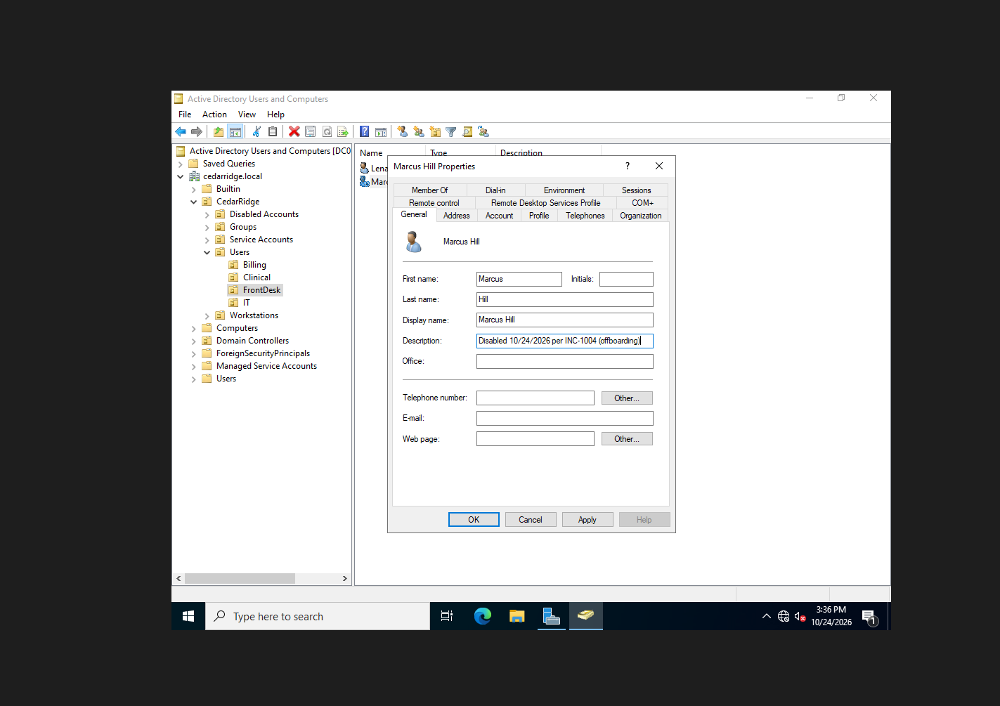

**Step 3. Remove group memberships.** Took him out of `GG_FrontDesk`. Only Domain Users is left, which is the primary group every account has and can't be removed. If the account ever got re-enabled by mistake, it still wouldn't carry any of his old access.

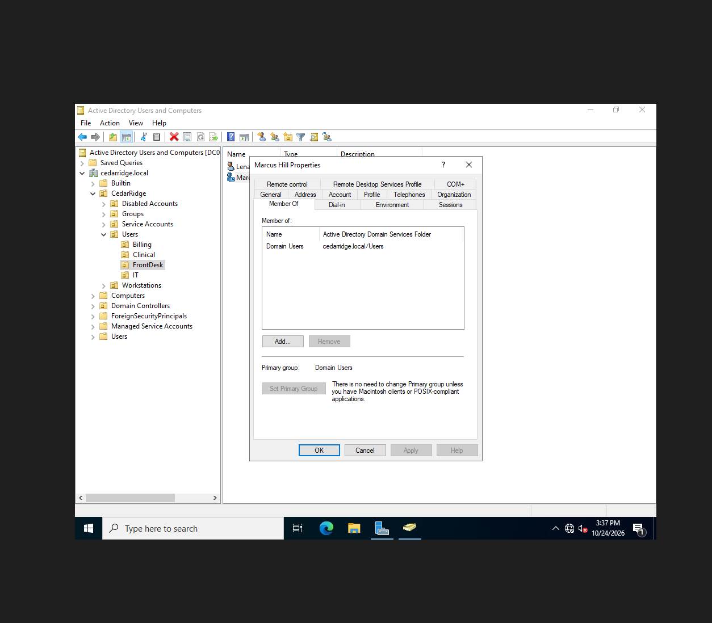

**Step 4. Move the account to Disabled Accounts.** This is the OU I built in Lab 1 for exactly this. It keeps the active department OUs clean and makes leftover accounts easy to find during an access review.

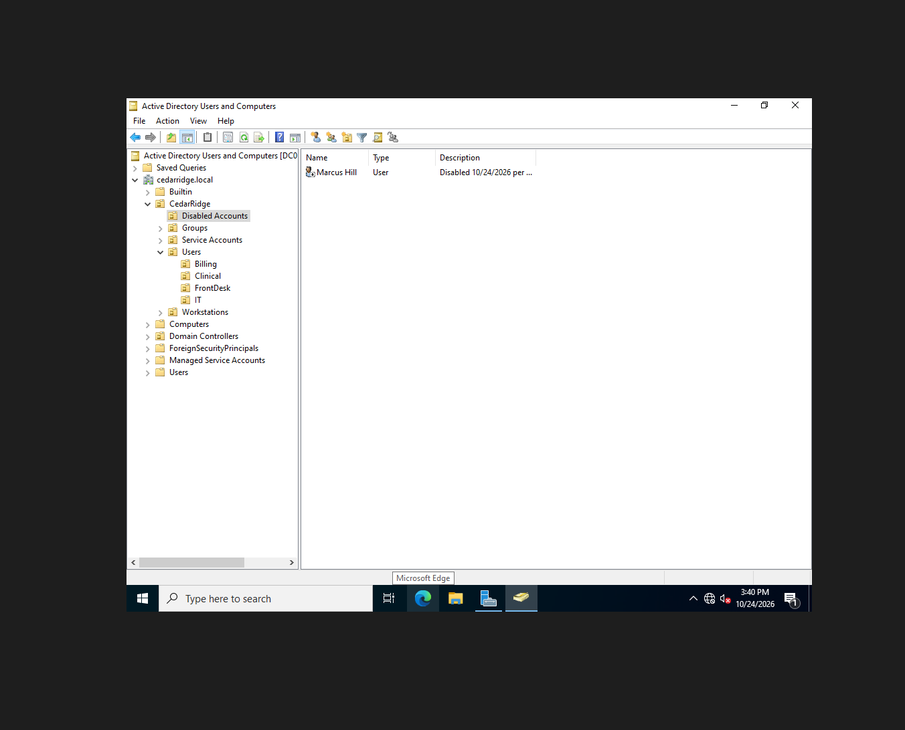

**Verify.** Tried to sign into CLIENT01 as `mhill`. Windows said "Your account has been disabled. Please see your system administrator." Access is gone.

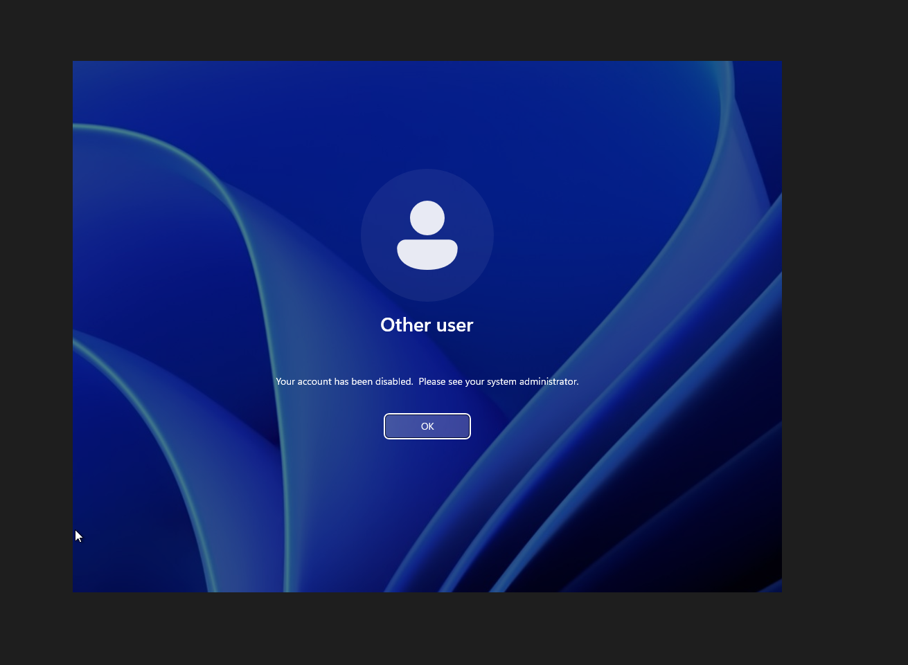

## Verification

One query to show where every account ended up:

```
Get-ADUser -Filter * -SearchBase "OU=CedarRidge,DC=cedarridge,DC=local" -Properties LockedOut, Description | Select Name, SamAccountName, Enabled, LockedOut, Description | Sort Name | Format-Table -AutoSize
```

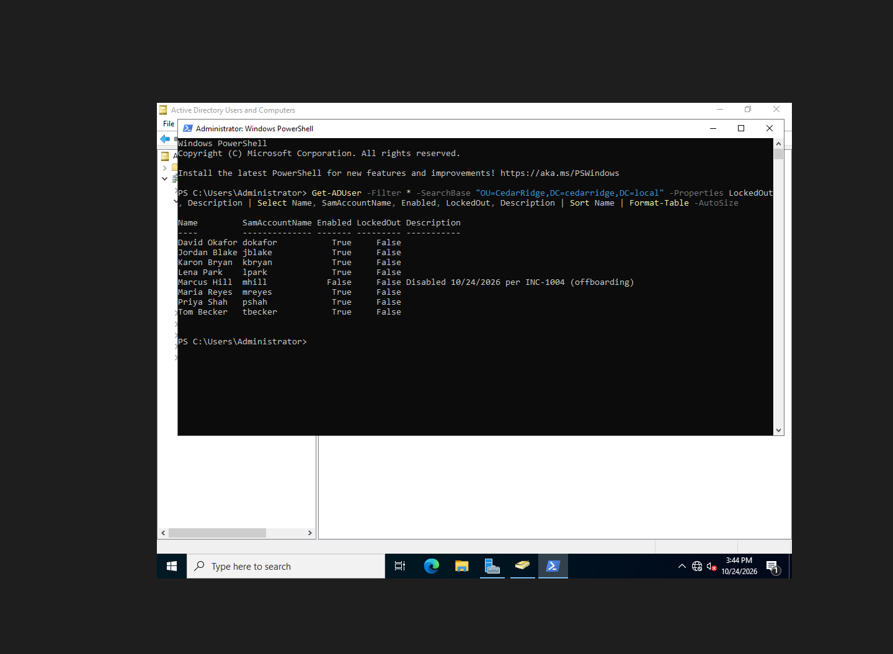

- Maria: enabled, not locked.
- Tom: enabled, using a password he set himself.
- Jordan: enabled.
- Marcus: disabled, with the offboarding note, sitting in Disabled Accounts.

I shut both VMs down and took a `lab2-complete` snapshot on each.

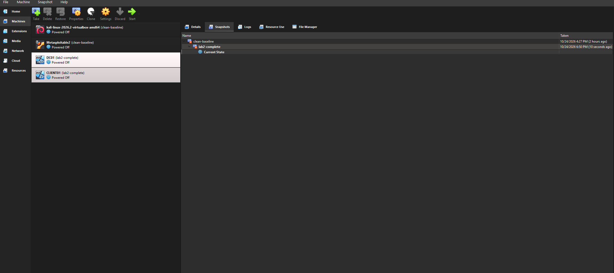

## Challenges and Fixes

**The lockout looked like it didn't work.** When I sent the bad passwords with `net use`, every attempt came back "System error 86, the specified network password is not correct." It never said "locked out." Right after, `net user mreyes /domain` still showed the account as active, so I figured the lockout hadn't happened and ran a second round of bad logins over LDAP. Then I pulled Event 4740 on the domain controller, and it showed Maria had been locked at 2:37 PM, during the first round. The client's error message wasn't telling the full story, and the domain controller's log was right the whole time. Now I check the DC's logs before deciding something didn't work.

**Password rejected even though it was complex.** When Maria had to set a new password, I tried one that was long and had upper and lower case, numbers, and a symbol, and Windows still rejected it. The reason was that it had "Maria" in it. Windows' complexity rule blocks any password that contains the user's account name or parts of their full name. I picked one without her name in it and it went through. Users hit this all the time, and now I know what to tell them.

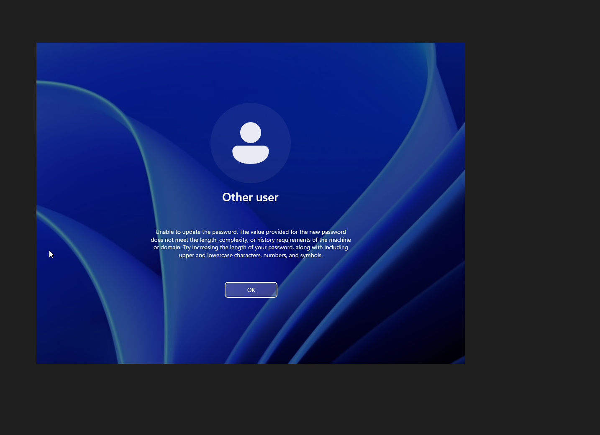

**Screenshots landing in the wrong place.** I set the Snipping Tool to save automatically, but it was still pointed at the Lab 1 folder, so half of this lab's screenshots ended up there. I moved and renamed them at the end. Small thing, but naming and organizing evidence matters as much as capturing it.

## What I Learned

- Unlocking an account is the easy part. Finding *why* it locked is the actual job, and Event 4740 with Caller Computer Name is how you do it.
- Identity verification comes before every password reset. The reset is only as secure as the check in front of it.
- Always reset to a temporary password with "must change at next logon," so the admin never knows the user's real password.
- Re-enabling an account needs approval behind it, same as granting access the first time.
- Offboarding is four steps: disable, document, strip groups, move. Never delete on day one.
- Domain password complexity rules include "can't contain your name," not just length and character types.
- When the client and the server disagree, trust the server's logs.

## Next Steps

IAM Lab 3: RBAC and Least Privilege. Shared folders for each department, with access granted through the GG_ groups, then tested by logging in as users from each department to prove they can only reach their own files.
